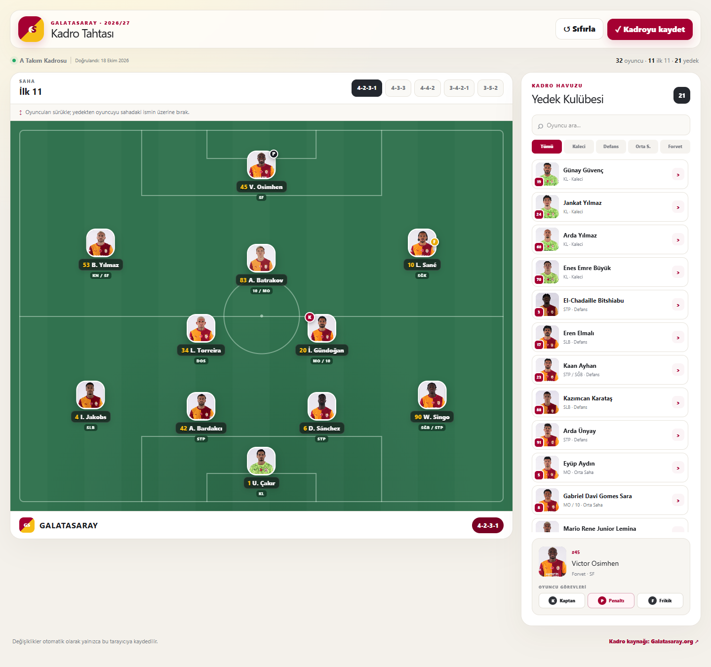
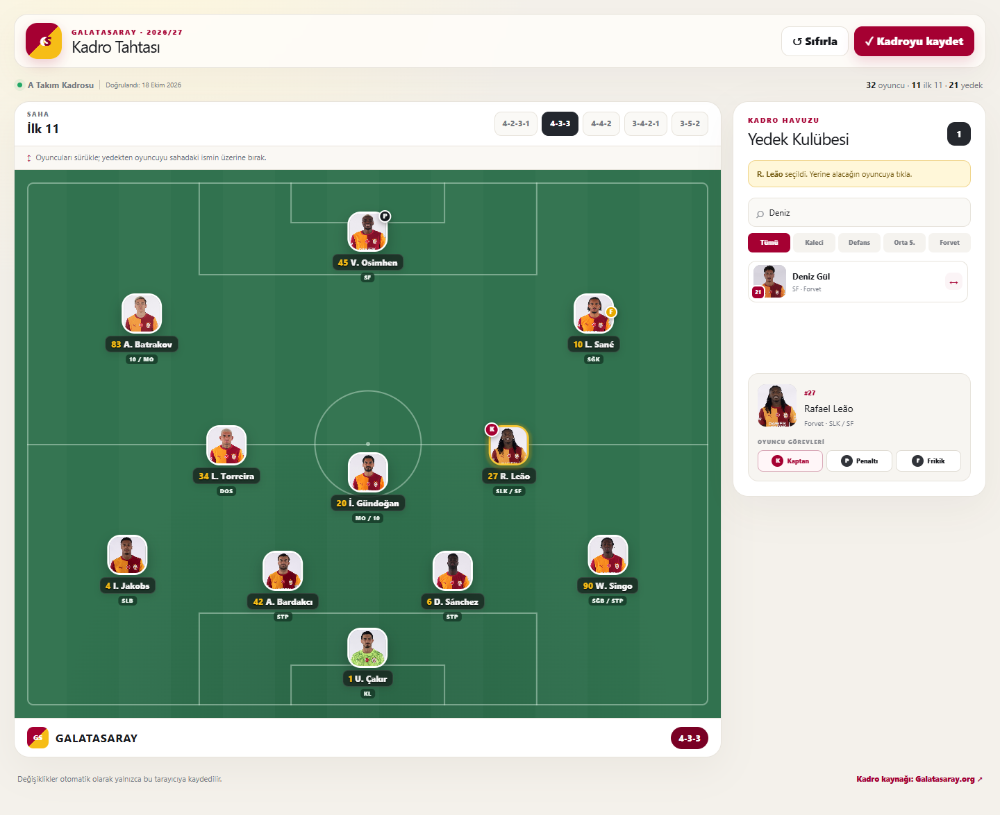
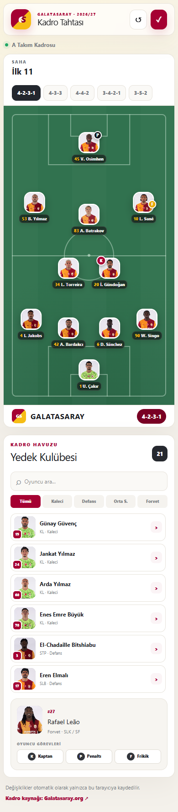

# Galatasaray Squad Board 🟡🔴

An interactive tactics board for building your own Galatasaray starting XI, trying different formations, and assigning player responsibilities. The application interface is in Turkish.

**Squad verified: October 18, 2026 · 32 players · 11 starters · 21 substitutes**

Player names, shirt numbers, position groups, and photos come from [Galatasaray's official first-team squad page](https://www.galatasaray.org/pl/futbol-takim-kadrosu/9). The default starting XI, captain, and set-piece takers are example selections for the application. They do not represent an official match lineup. Detailed tactical role labels are provided as application-specific guidance.

## Why this project was built

A player list alone does not show how different starting lineups would look on the pitch. This project brings player positioning, formation changes, and substitutions into one screen so fans can explore their own tactical ideas. Red and yellow accents reflect the club's identity, while the green pitch makes player placement easy to read.

## Screenshots and design decisions

### Desktop: the pitch and squad pool side by side



The pitch occupies the main area, with the substitutes panel on the right. This keeps the formation visible while browsing players. Formation buttons apply coordinate templates; moving players manually creates a custom formation, labeled “Özel” in the interface. The K, P, and F badges identify the captain, penalty taker, and free-kick taker.

### Substitutions: select, search, and replace



Click a player on the pitch, then click a substitute to replace them. A selection highlight and a notice show which position will change. In this example, Leão has been brought into the lineup and made captain, while Deniz Gül is being searched for. Name and shirt-number search, together with position filters, help narrow down the squad. On desktop, substitutes can also be dragged onto the pitch.

### Mobile: a vertical layout



On narrow screens, the panels stack vertically and player cards become smaller while keeping the main controls available. Tap a player on the pitch, then a substitute, to make a change. Percentage-based coordinates let the player layout adapt to the screen size.

## Features

- Five formation presets: 4-2-3-1, 4-3-3, 4-4-2, 3-4-2-1, and 3-5-2.
- Free player positioning and substitutions.
- Name and shirt-number search with Turkish character support, plus position filters.
- Captain, penalty taker, and free-kick taker assignments.
- Automatic lineup persistence in the browser's `localStorage`, with a reset option.
- A command to refresh squad data and photos from the official source.

## How it works

The interface uses **React 19 and TypeScript**. **vinext** runs the Next.js App Router structure on Vite and handles development and production builds. The layout uses CSS Grid, Flexbox, media queries, and CSS variables; Tailwind CSS is also included in the project setup.

Player data is kept separately from the interface in `data/roster.json`. Each starting-XI slot contains a player ID and percentage-based `x/y` coordinates. Selecting a formation updates those coordinates, while making a substitution changes the player assigned to a slot. Pointer events handle movement on the pitch, and HTML drag-and-drop events support bringing substitutes onto the pitch on desktop.

Lineups are stored in the browser, so these features do not require an account or database. Saved data is validated before use. Clearing browser storage also removes the saved lineup. The D1/Drizzle examples come from the starter infrastructure and are not used by the squad board.

```text
app/page.tsx                    Interactions, pitch, and player cards
app/globals.css                 Club colors, pitch markings, and responsive layout
data/roster.json                Source, verification date, and player data
public/players/                 Local player photos
scripts/update-roster.mjs       Official squad and photo refresh
scripts/capture-screenshots.mjs Browser checks and screenshot capture
tests/rendered-html.test.mjs    Data integrity and production HTML checks
docs/screenshots/              README screenshots
```

## Run locally

Requires **Node.js 22.13 or later**.

```bash
npm ci
npm run dev
```

Open the local address shown in the terminal. On Windows, you can also use `Siteyi Baslat.cmd` after installing the dependencies.

```bash
npm run build   # Build for production
npm start       # Start the production server
npm run lint    # Check code quality
npm test        # Build, then run squad and server-rendered HTML tests
```

## Update the squad

```bash
npm run roster:update
npm test
```

The update command fetches player names, shirt numbers, position groups, and photos from the official page, then refreshes the verification date. It preserves existing players' short names and tactical role labels. New players receive a general role; detailed roles and short names can be edited in the JSON file. If the source structure is unexpected or a photo cannot be fetched, the command fails without replacing the roster data file.

Updates are run manually. When the official squad page changes, rerun the command, review the changes, and publish a new version.

## Regenerate screenshots

With the development server running and Google Chrome installed:

```bash
node scripts/capture-screenshots.mjs
```

The script checks the 11-player lineup, substitute count, photos, formation changes, substitutions, captain assignment, persistence after a reload, and mobile overflow. It then saves three PNG screenshots. Set the `PREVIEW_URL` environment variable to test a different address.

## Attribution

This is an independent fan project and is not an official application of Galatasaray Spor Kulübü. Player photos and club-related visual rights belong to their respective rights holders. Source links are also included in `data/roster.json`.
